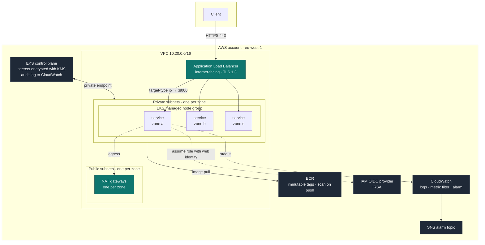
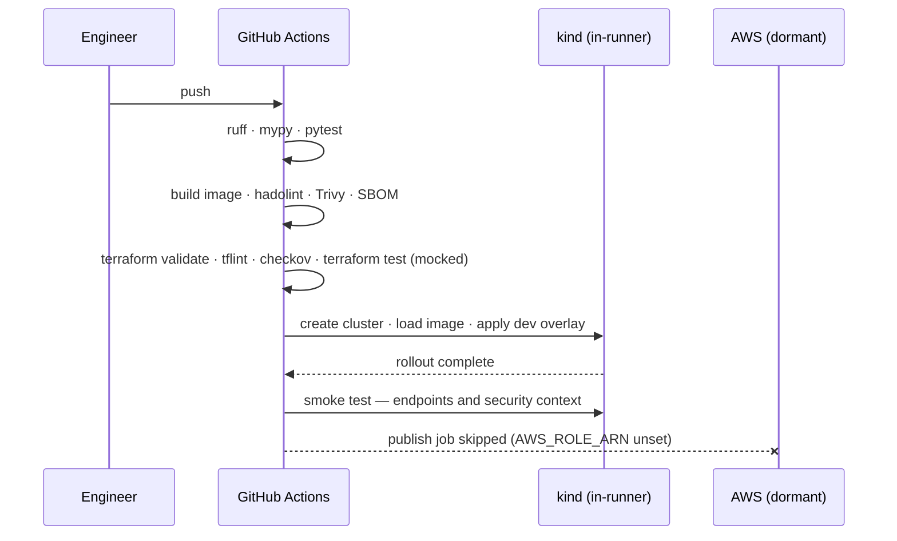

# Architecture

## Topology

## Request path

1. The client resolves the record and connects to the Application Load Balancer over
   TLS 1.3. The load balancer is the only internet-facing component.
2. The AWS Load Balancer Controller has registered pod IP addresses directly in the
   target group (`target-type: ip`), so the request reaches a container without a
   second hop through a node port.
3. Targets are health-checked against `/readyz`, not `/healthz`. A draining instance
   withdraws readiness and is removed from rotation while it is still serving its
   in-flight requests.
4. The pod runs in a private subnet as UID 10001, on a read-only root filesystem,
   with every Linux capability dropped, under the `restricted` Pod Security
   Admission profile.

## Trust boundaries

| Boundary | Control |
| --- | --- |
| Internet to load balancer | Security group; TLS 1.3 policy; invalid header fields dropped |
| Load balancer to pod | NetworkPolicy admits port 8000 only; default deny for everything else |
| Pod to AWS API | IRSA: a token scoped to one service account, exchanged for credentials valid for 15 minutes |
| Pod to node metadata | IMDSv2 required, hop limit 1 — the container cannot reach the metadata service |
| Node to control plane | Private endpoint; public endpoint restricted to an explicit allow-list |
| Control plane to etcd | Secrets encrypted with a customer-managed KMS key that rotates automatically |

## Failure domains

The platform spans three availability zones. Each holds one public subnet, one
private subnet, its own NAT gateway and at least one replica, and the production
overlay sets `whenUnsatisfiable: DoNotSchedule` on the zonal spread constraint so a
schedule that would concentrate replicas fails loudly instead.

Losing a zone therefore removes one third of capacity: the surviving zones keep
their own egress path, the load balancer stops targeting the lost addresses within
two failed health checks, and the autoscaler replaces the capacity in the zones that
remain.

The development environment deliberately trades this away — one NAT gateway, spot
capacity, `ScheduleAnyway` — and each trade-off is annotated at the point it is made
in `terraform/envs/dev/main.tf`.

## Deployment flow

## What is intentionally absent

- **A service mesh.** The workload is a single service; mTLS between one service and
  itself buys nothing that a NetworkPolicy does not already provide.
- **A GitOps controller.** Argo CD or Flux would be the next step for a real
  platform, but the deployment path here terminates at a cluster that CI creates and
  destroys within the same job.
- **Multi-region.** The recovery objectives that would justify the second region
  have not been stated, and inventing them would produce architecture without a
  requirement behind it.
